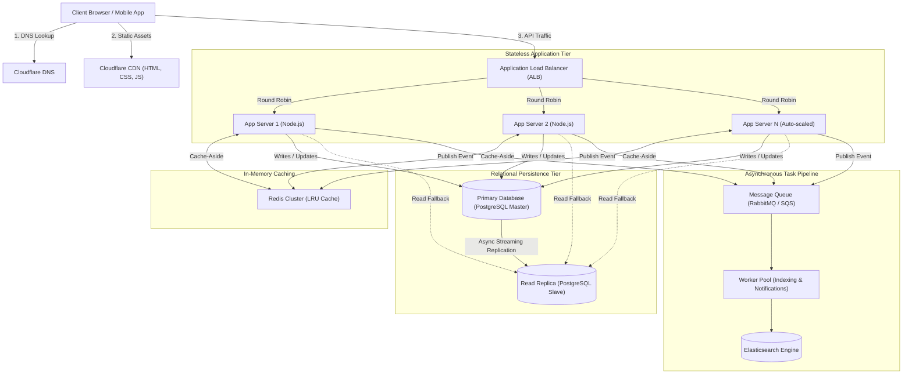

# QuickNotes System Architecture Design

## 1. Requirements

### 1.1. Functional Requirements
- **User Authentication:** Users can register, log in, and manage active sessions securely.
- **Note Management (CRUD):** Users can create, view, edit, and delete notes.
- **Tag Organization:** Users can create custom tags and attach multiple tags to individual notes.
- **Search & Pagination:** Users can view their notes chronologically with page-based pagination and search notes by tag.

### 1.2. Non-Functional Requirements
- **High Availability:** 99.9% uptime target (less than 8.76 hours of unplanned downtime per year).
- **Low Latency:** P95 response times below 100 ms for read operations and below 250 ms for write operations.
- **Scalability:** Capable of horizontally scaling to support 1,000,000 registered accounts.
- **Durability & Consistency:** Strong data durability guarantees (RPO = 0 for committed notes) with read-your-own-writes consistency.

---

## 2. Load & Storage Estimates (1,000,000 Users)

### Assumptions
- **Registered User Base:** 1,000,000 users.
- **Daily Active Users (DAU):** 20% of registered base = 200,000 DAU.
- **Read-to-Write Ratio:** 10:1 (users view and browse their notes far more frequently than they write or edit).
- **Daily User Activity:**
  - 20 note reads / DAU / day = $200,000 \times 20 = 4,000,000\text{ reads/day}$.
  - 2 note writes / DAU / day = $200,000 \times 2 = 400,000\text{ writes/day}$.

---

### Computations

#### 1. Reads Per Second (QPS)
- **Average Read QPS:**
  $$\text{Average Read QPS} = \frac{4,000,000\text{ reads}}{86,400\text{ seconds}} \approx 46.3\text{ reads/sec}$$
- **Peak Read QPS (2.5x traffic surge):**
  $$\text{Peak Read QPS} = 46.3 \times 2.5 \approx 116\text{ reads/sec}$$

#### 2. Writes Per Second (QPS)
- **Average Write QPS:**
  $$\text{Average Write QPS} = \frac{400,000\text{ writes}}{86,400\text{ seconds}} \approx 4.6\text{ writes/sec}$$
- **Peak Write QPS (2.5x traffic surge):**
  $$\text{Peak Write QPS} = 4.6 \times 2.5 \approx 11.5\text{ writes/sec}$$

#### 3. Storage Estimates Per Year
- **Average Note Footprint:**
  - Title (100 bytes) + Body (1,000 bytes) + Metadata & Foreign Keys (100 bytes) $\approx 1.2\text{ KB/note}$.
- **Annual Note Count:**
  $$400,000\text{ notes/day} \times 365\text{ days} = 146,000,000\text{ notes/year}$$
- **Raw Storage:**
  $$146,000,000 \times 1.2\text{ KB} \approx 175.2\text{ GB/year}$$
- **With Database Indexing Overhead (+40%):**
  $$\approx 245\text{ GB of storage per year}$$

---

## 3. High-Level Architecture Diagram

## 4. Component Explanations (Problem Solved)

- **Client**: Renders the application interface, validates user inputs, and initiates asynchronous HTTPS requests.
- **DNS (Domain Name System)**: Resolves the domain quicknotes.io into healthy ingress IP addresses with low-latency geo-routing.
- **CDN (Content Delivery Network)**: Serves cached static frontend assets (index.html, style.css, api.js) from edge points of presence to eliminate round-trip latency.
- **Application Load Balancer (ALB)**: Distributes incoming HTTP traffic evenly across backend servers and performs continuous health checks to reroute around failing nodes.
- **App Servers (Stateless Cluster)**: Executes business rules, verifies JSON Web Tokens (JWT), performs input sanitation, and coordinates data access across caches and databases.
- **Cache (Redis Cluster)**: Stores serialized note collections in RAM using a cache-aside pattern to serve frequent reads in under 5 ms and prevent database connection exhaustion.
- **Primary Database (PostgreSQL Master)**: Serves as the authoritative source of truth that processes all writes, updates, deletes, and ACID transactions.
- **Read Replica (PostgreSQL Slave)**: Offloads non-cached read queries from the primary database via asynchronous streaming replication.
- **Message Queue (RabbitMQ / SQS)**: Decouples heavy operations (search index updates and email notifications) from the synchronous HTTP request-response cycle.
- **Worker Service**: Consumes background queue events to process data indexing into Elasticsearch without degrading user-facing API response times.

## 5. Step-by-Step Request Flows

### 5.1. GET /notes Flow (Cache-Aside Strategy)

1. **Request:** The user opens the notes dashboard; the client issues GET /api/v1/notes?page=1&limit=10 with an Authorization: Bearer <token> header.
2. **Ingress:** The Load Balancer terminates SSL/TLS and forwards the request to an available App Server instance.
3. **Authentication:** The App Server validates the JWT signature and extracts the user_id.
4. **Cache Lookup:** The App Server queries the Redis cluster using the key user:{user_id}:notes:page:1.
    - **Cache Hit:** Redis returns the cached JSON payload. The App Server immediately returns 200 OK to the client (sub-15 ms total latency).
    - **Cache Miss:** The App Server queries the PostgreSQL Read Replica (SELECT ... FROM notes WHERE user_id = ...).
5. **Cache Hydration:** Upon receiving the database records, the App Server writes the result into Redis with a 15-minute Time-To-Live (TTL).
6. **Response:** The App Server formats the response JSON and returns 200 OK to the client.

### 5.2. POST /notes Flow (Transactional Write & Event Broadcast)

1. **Submission:** The user completes the note form; the client issues POST /api/v1/notes containing { "title": "...", "body": "...", "tag_ids": [...] }.
2. **Validation:** The App Server inspects the payload, verifying the title is present and does not exceed 100 characters.
3. **Database Write:** The App Server opens an ACID transaction against the Primary Database (Master):
    - Inserts the new row into the notes table.
    - Inserts association rows into the note_tags junction table.
    - Commits the transaction and receives the newly generated id and timestamps.
4. **Cache Invalidation:** The App Server clears existing cached list entries for this user in Redis (DEL user:{user_id}:notes*).
5. **Async Publication:** The App Server pushes a NoteCreated message into the Message Queue.
6. **Client Response:** The App Server sends 201 Created with the complete note entity to the client.
7. **Background Execution:** The Worker Service picks up the NoteCreated message from the queue and updates the full-text search index asynchronously.
## 6. Architectural Trade-offs & Single Points of Failure
### 6.1. Architectural Trade-offs
**Trade-off 1:** Asynchronous Database Replication vs Read-Your-Own-Writes Consistency
- **Choice:** Asynchronous streaming replication between Primary and Read Replica.
- **Advantage:** Preserves maximum write throughput on the Primary DB; allows read replicas to be added without slowing down write operations.
- **Drawback:** Slight replication lag (typically 20–100 ms). A user creating a note and instantly reloading the page could query a replica before the replication stream catches up.
- **Resolution:** The App Server enforces a "read-after-write" policy: any read request originating from a user within 2 seconds of a mutation is directed either to the primary database or directly to the freshly hydrated cache.
**Trade-off 2:** In-Memory Redis Caching vs System Complexity & Hardware Cost
- **Choice:** Introducing Redis as an independent in-memory caching tier instead of querying PostgreSQL directly.
- **Advantage:** Lowers read latency from ~35 ms to < 5 ms, protecting the database from high traffic spikes.
- **Drawback:** Introduces cache invalidation complexity (stale data risks) and increases infrastructure running costs.
- **Resolution:** Deterministic cache key invalidation on every write/update/delete operation coupled with an aggressive 15-minute TTL.
### 6.2. Eliminating Single Points of Failure (SPOF)
|Component Layer|Potential Failure|Redundancy & Recovery Strategy|
|---|---|---|
|Ingress / Routing|Load Balancer crash|Multi-Availability-Zone (Multi-AZ) ALB deployment backed by DNS failover via Anycast IP|
|Application Tier|Server crash or unhandled exception|Stateless server pool (minimum 3 instances across 3 AZs) managed by an Auto Scaling Group with active health-check replacement|
|Caching Tier|Redis master node failure|Redis Sentinel / Cluster setup with automated primary-replica failover in under 5 seconds|
|Persistence Tier|Primary DB hardware failure|Multi-AZ PostgreSQL configuration with synchronous standby replica; automated promotion of standby to primary within 30 seconds|
|Message Queue|Queue broker crash|Clustered RabbitMQ nodes with disk persistence and message acknowledgment semantics to guarantee at-least-once delivery|